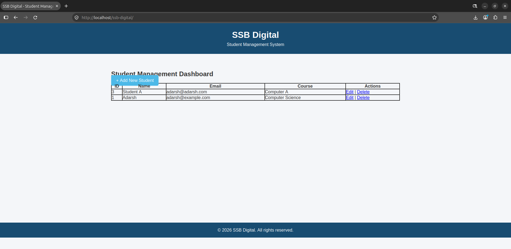
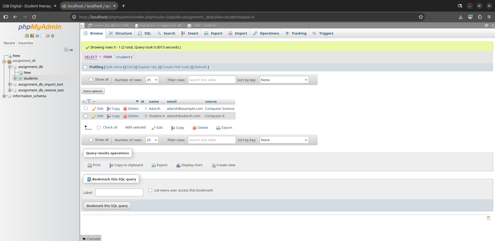
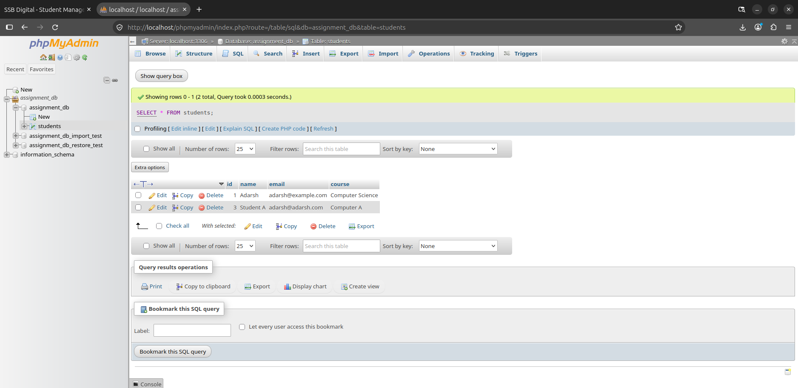
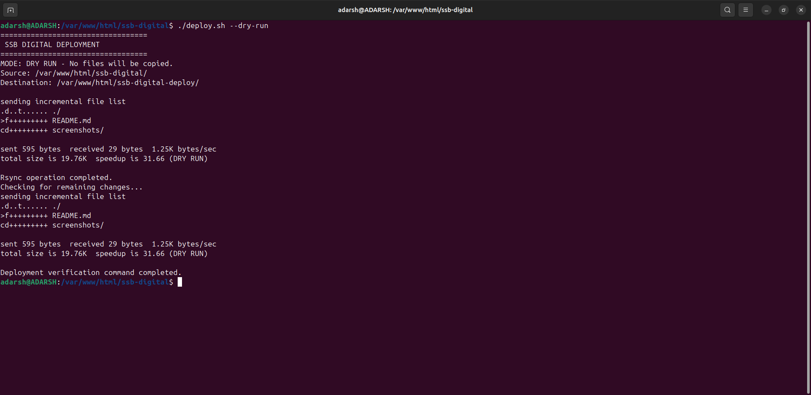
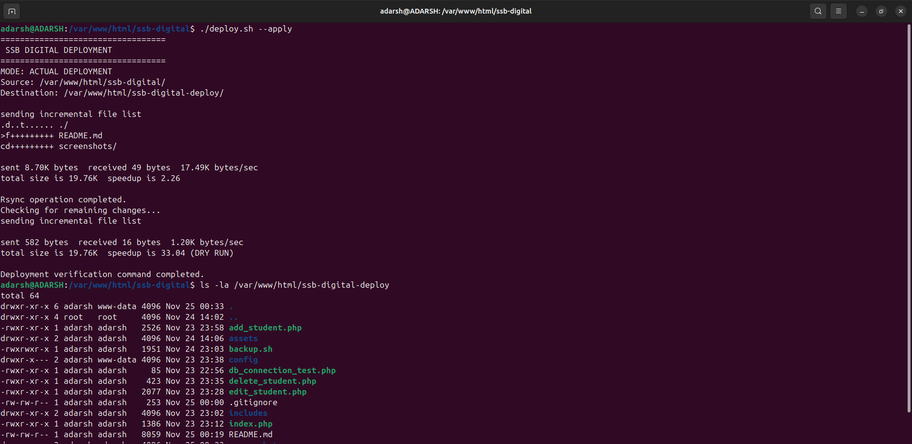
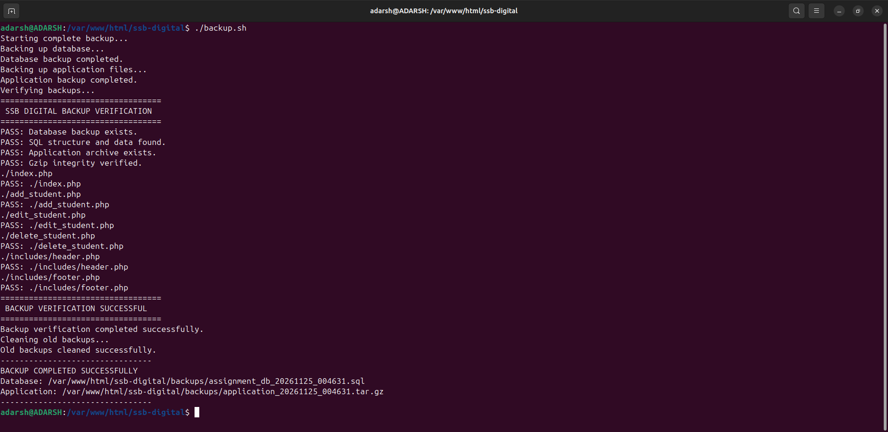
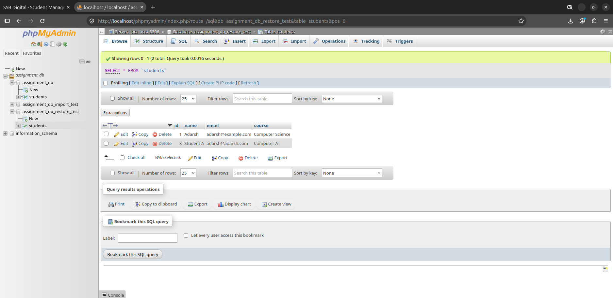
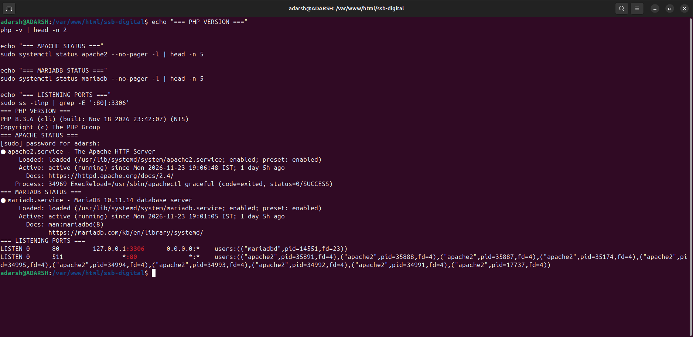

# SSB Digital – Student Management System

A PHP and MariaDB-based Student Management System developed for the **SSB Digital Junior DevOps / Web Operations Engineer Take-Home Assignment**.

This project demonstrates Linux administration, Apache and PHP configuration, database management, PHP CRUD operations, Rsync deployment, Git version control, automated backups, backup verification, and basic security practices.

## 1. Project Overview

The application allows users to manage student records through a web interface.

### Features

- Display student records.
- Add new student records.
- Edit existing student records.
- Delete student records.
- Connect to MariaDB using PHP PDO.
- Deploy application files using Rsync.
- Create database and application-file backups.
- Automatically verify newly created backups.
- Clean up backups older than seven days.

## 2. Technology Stack

| Component | Version / Technology |
|---|---|
| Operating System | Ubuntu Linux (VMware virtual machine) |
| Web Server | Apache2 |
| Backend | PHP 8.3.6 |
| Database | MariaDB 10.11.14 |
| Database Administration | phpMyAdmin |
| Deployment | Rsync 3.2.7 |
| Version Control | Git |
| Backup | mysqldump and tar |
| Scripting | Bash |

## 3. Project Structure

```text
ssb-digital/
├── assets/
│   └── style.css
├── config/
│   └── database.php
├── includes/
│   ├── header.php
│   └── footer.php
├── add_student.php
├── delete_student.php
├── edit_student.php
├── index.php
├── db_connection_test.php
├── deploy.sh
├── backup.sh
├── verify_backup.sh
└── .gitignore
```

The database configuration file is kept outside version control.

## 4. Prerequisites

- Ubuntu Linux
- Apache2
- PHP 8.3 or compatible version
- PHP PDO MySQL extension
- MariaDB or MySQL
- phpMyAdmin
- Rsync
- Git

## 5. Service Management

Start services:

```bash
sudo systemctl start apache2
sudo systemctl start mariadb
```

Check service status:

```bash
sudo systemctl status apache2
sudo systemctl status mariadb
```

Stop services:

```bash
sudo systemctl stop apache2
sudo systemctl stop mariadb
```

Restart services:

```bash
sudo systemctl restart apache2
sudo systemctl restart mariadb
```

## 6. Application Setup

Place the project in:

```text
/var/www/html/ssb-digital
```

Configure the database connection in the private file:

```text
config/database.php
```

Do not commit database credentials or other secrets.

Start Apache and MariaDB, then access:

**Application:** http://localhost/ssb-digital/

**phpMyAdmin:** http://localhost/phpmyadmin

## 7. Database Setup

The application uses:

- Database: `assignment_db`
- Table: `students`
- Application database account: a dedicated non-root account

The application supports the following SQL operations:

```sql
SELECT * FROM students;

INSERT INTO students (...) VALUES (...);

UPDATE students SET ... WHERE ...;

DELETE FROM students WHERE ...;
```

A sanitized database schema and sample-data files will be provided separately in the submission.

## 8. Rsync Deployment

The deployment script synchronizes the source application with:

```text
/var/www/html/ssb-digital-deploy
```

First, simulate deployment:

```bash
./deploy.sh --dry-run
```

Apply deployment:

```bash
./deploy.sh --apply
```

The script validates required directories, application files, destination database configuration, and Rsync availability.

It excludes Git metadata, environment files, logs, local backups, SQL files, temporary backup files, and the source database configuration.

A final Rsync dry-run checks whether any differences remain.

## 9. Backup Procedure

Run the backup script:

```bash
./backup.sh
```

The script creates two timestamped files in:

```text
/var/www/html/ssb-digital/backups/
```

Example naming convention:

```text
assignment_db_YYYYMMDD_HHMMSS.sql
application_YYYYMMDD_HHMMSS.tar.gz
```

### Database backup

The database is exported using `mysqldump` with:

- Credentials loaded from `$HOME/.my.cnf`.
- `--single-transaction` for the database dump.
- A temporary file before the final backup is created.

### Application backup

The application is archived using `tar -czf`.

The archive excludes:

- The local `backups/` directory.
- Git metadata (`.git/`).

The archive includes the private application configuration, so it must be treated as sensitive.

### Backup security

- Backup directory permissions: `700`.
- Database backup permissions: `600`.
- Application archive permissions: `600`.
- Database credentials are stored in a private MySQL option file, not in the backup script.

### Automatic verification

After creating both backups, `backup.sh` automatically runs:

```bash
bash verify_backup.sh /path/to/database_backup.sql
```

The verification script checks:

1. Database backup exists and is non-empty.
2. SQL contains table creation and inserted data.
3. Matching application archive exists.
4. Gzip archive integrity.
5. Essential PHP application files are present in the archive.

If verification fails, the backup script stops rather than reporting a successful backup.

### Retention

The backup script removes matching database and application backup files older than seven days.

## 10. Database Restore

Restore verification should use a separate test database so the working application database remains untouched.

Create a test database:

```bash
mariadb -u adarsh -p -e "CREATE DATABASE test_database;"
```

Import a selected SQL backup:

```bash
mariadb -u adarsh -p test_database < /path/to/assignment_db_backup.sql
```

Verify the restored database:

```bash
mariadb -u adarsh -p test_database
```

Then execute:

```sql
SHOW TABLES;
SELECT * FROM students;
```

Confirm that the expected records are available.

The test database must exist before importing the SQL file.

## 11. Security Practices

- Database credentials are kept outside committed source code.
- `config/database.php` is excluded through `.gitignore`.
- SQL backups and application archives are excluded from Git.
- Deployment excludes private database configuration.
- The application uses a dedicated database account instead of root.
- Backup files have restrictive permissions.
- The application is not made world-writable.

## 12. Logs and Troubleshooting

Important log locations:

| Service | Log location |
|---|---|
| Apache access log | `/var/log/apache2/access.log` |
| Apache error log | `/var/log/apache2/error.log` |
| MariaDB service | `journalctl -u mariadb` |

Check Apache errors:

```bash
sudo tail -f /var/log/apache2/error.log
```

Check MariaDB service logs:

```bash
sudo journalctl -u mariadb -f
```

Check service status:

```bash
sudo systemctl status apache2 mariadb
```

A separate incident report will document the simulated issue, investigation, cause, corrective action, and prevention.

## 13. Git Version Control

Check repository status:

```bash
git status
```

View commit history:

```bash
git log --oneline
```

The `.gitignore` file excludes sensitive configuration, local database backups, and temporary files.

## 14. Development Environment

The project is developed and tested in an Ubuntu virtual machine using VMware Workstation.

The application runs locally using Apache and MariaDB.

No paid cloud services, Kubernetes, Terraform, or other advanced infrastructure are required for this assignment.

## 15. Project Status

Implemented and tested:

- PHP student management CRUD operations.
- MariaDB connectivity.
- phpMyAdmin access and SQL import/export.
- Rsync dry-run and actual deployment.
- Database and application-file backups.
- Automated backup verification.
- Backup integrity and negative verification tests.
- Restore into a separate test database.
- Git exclusions for sensitive and temporary files.

Documentation, sanitized SQL deliverables, troubleshooting evidence, final Git history, and submission packaging are being completed.

---

**Assignment:** SSB Digital – Junior DevOps / Web Operations Engineer Take-Home Assignment

## Screenshots and Evidence

The following screenshots demonstrate the application, database operations, deployment process, backup and restore procedures, and Linux environment.

### 1. PHP Student Management Application


### 2. phpMyAdmin Database and Student Records


### 3. SQL Operations


### 4. Rsync Deployment Dry Run


### 5. Successful Application Deployment


### 6. Database and Application Backup Verification


### 7. Database Restore Verification


### 8. Linux, Apache, MariaDB and PHP Environment

